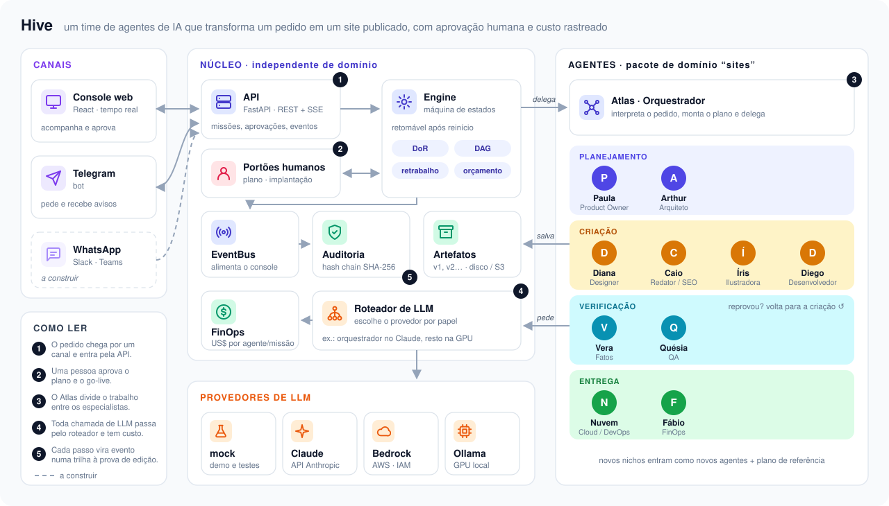

# 🐝 Hive: plataforma multi-agente auditável

Você envia uma **missão** pela web ou pelo Telegram, por exemplo: *"Crie um site para a empresa X, do segmento Y, apresente…"*. A partir daí:

1. O orquestrador **Atlas** interpreta o pedido e monta um briefing.
2. Atlas planeja as tarefas como um grafo de dependências (DAG), escritas como **histórias com Definition of Ready**.
3. Atlas delega cada tarefa a um especialista: PO, arquiteto, designer, redator, desenvolvedor, QA, cloud e FinOps.

Tudo fica numa **trilha de auditoria encadeada por hash**. Ela registra quem fez o quê, com quais insumos, quais evidências, qual modelo de IA e quanto custou, do pedido até o site publicado.



Detalhes em [docs/architecture.md](docs/architecture.md).

Primeiro pacote de domínio: **Agência Digital para PMEs** (sites institucionais).

## Rodando localmente

Pré-requisitos: Python ≥ 3.12 com [uv](https://docs.astral.sh/uv/) e Node 22.

```bash
# 1. Console web (build estático, servido pela API)
cd web && npm install && npm run build && cd ..

# 2. API + agentes
cd backend
cp .env.example .env          # modo mock: sem chaves, custo zero
uv sync
uv run uvicorn hive.api.app:app --port 8001
```

Abra <http://localhost:8001>, clique em **Exemplo 1** e depois em **Enviar ao orquestrador**. Aprove o plano e, depois do QA, a implantação.

Para desenvolver o front com hot reload, rode `cd web && npm run dev` (http://localhost:5173, com proxy para a API).

Testes: `cd backend && uv run pytest`. Eles cobrem o fluxo completo, os portões de aprovação, o retrabalho do QA, o deploy, o FinOps, a detecção de adulteração da trilha e o estouro de orçamento.

## Provedores de LLM

| `HIVE_LLM_PROVIDER` | Quando usar | Custo |
|---|---|---|
| `mock` | Demo, testes, CI | Zero; mostra o custo-sombra que a missão teria num modelo real |
| `anthropic` | Claude via API (`ANTHROPIC_API_KEY`) | Por token |
| `bedrock` | Claude na AWS, autenticado por IAM | Por token (tabela Bedrock) |
| `ollama` | GPU local, ex.: RX 9070 XT com `gpt-oss:20b` ([guia](docs/llm-local.md)) | Energia |

O roteamento padrão é **Opus 5.5 no orquestrador** e **Sonnet 5.5 nos especialistas**. Dá para trocar o modelo por papel com `HIVE_ROUTING`, inclusive num modo híbrido Claude + modelo local. Se o Claude recusar uma solicitação, a plataforma tenta de novo uma vez com `HIVE_FALLBACK_MODEL`.

## Telegram

1. Crie um bot com o [@BotFather](https://t.me/BotFather).
2. Defina `HIVE_TELEGRAM_BOT_TOKEN` no `.env` e reinicie a API.
3. Mande a missão em texto livre para o bot.

Você recebe o briefing, o plano com botões **Aprovar/Rejeitar**, o andamento de cada agente e o link do site publicado. O bot funciona por long polling, então não precisa de URL pública.

## O que você vê no console

- **Jornada** do pedido ao site no ar, com os portões de decisão destacados em mel: a única cor reservada para o que depende de você.
- **Cronograma da colônia** (Gantt): uma linha por agente, com retrabalho hachurado, chamadas de modelo marcadas na barra e a linha **Você**, que mostra quanto tempo a missão esperou por aprovação humana.
- **Fluxo de delegação** (grafo). Ao clicar num agente, abre a história DoR, os insumos, as entregas, as evidências, os artefatos e os playbooks usados.
- **Entrega**: prévia do site antes da publicação (sem scripts, com CSP restrita) e galeria das ilustrações, indicando quais vieram do modelo e quais do plano B procedural.
- **Linha do tempo**, **Auditoria** (integridade da cadeia de hashes e quem fez o quê), **Custos** e **Artefatos**.
- **Pendências de fatos no go-live**: o que a verificação de fatos não conseguiu resolver aparece no portão de publicação, para você decidir.
- **Tentar de novo**: uma missão que falhou retoma do ponto em que parou, mantendo o que já foi entregue e aprovado, com orçamento opcional maior. A nova tentativa fica na trilha de auditoria.
- **Comparar**: missões lado a lado (modelo, tempo, tokens/s, custo, retrabalho e ilustrações), com o melhor valor de cada linha em destaque.
- Tema claro e escuro, responsivo até a largura de celular.

## Playbooks dos agentes

São guias de ofício em Markdown com frontmatter (`backend/src/hive/playbooks/*.md`), no espírito das Agent Skills. Cada um declara os papéis que o recebem (`roles`) e é injetado no prompt de sistema desses agentes. Cada delegação registra na trilha de auditoria o nome, a versão e o hash dos playbooks usados (`web-quality@1.0.0#1d88735b`).

| Playbook | Agentes | Para quê |
|---|---|---|
| `web-quality` | Diego | As mesmas verificações do QA, aplicadas antes da entrega (menos retrabalho) |
| `design-system` | Diana, Diego | Paleta, contraste, tema escuro e neon bem dosado |
| `seo-copy` | Caio, Paula | Limites de SEO e **proibição de inventar fatos** sobre o cliente |
| `svg-illustration` | Íris | Regras de SVG seguro, composição e brilho neon |

Para medir modelos, `uv run python scripts/run_mission.py "<pedido>"` executa uma missão de ponta a ponta, aprovando os portões, e imprime tempo, tokens, retrabalho e falhas por agente.

Para criar um playbook, adicione um `.md` na pasta e reinicie a API.

## MCP para desenvolvimento

O `.mcp.json` do projeto registra o **Playwright MCP** (`@playwright/mcp@0.0.83`, headless). Com ele, o Claude Code navega no console e nos sites gerados, tira prints e lê erros de console. O navegador precisa de bibliotecas do sistema que não vêm no WSL:

```bash
sudo apt-get install -y libnss3 libnspr4 libasound2t64
```

O design do console seguiu a skill oficial `frontend-design` (plugin `frontend-design@claude-plugins-official`).

## Estrutura

```
backend/src/hive/
  agents/      orquestrador + especialistas (pacote "Agência Digital"), QA determinístico, ilustração SVG
  playbooks/   conhecimento de ofício por papel (Markdown + frontmatter)
  core/        engine (máquina de estados), eventos/auditoria, banco, artefatos
  llm/         provedores (mock, Claude API, Bedrock, Ollama) e tabela de preços
  channels/    Telegram (+ contrato para WhatsApp/Slack/Teams)
  api/         FastAPI: REST + SSE + console + sites publicados
web/           console React (React Flow para o grafo)
docs/          arquitetura, FinOps, LLM local
```

## Documentação

- [Arquitetura e caminho para a AWS](docs/architecture.md)
- [FinOps: custos fixos, por missão e por entrega](docs/finops.md)
- [LLM local na RX 9070 XT](docs/llm-local.md)
