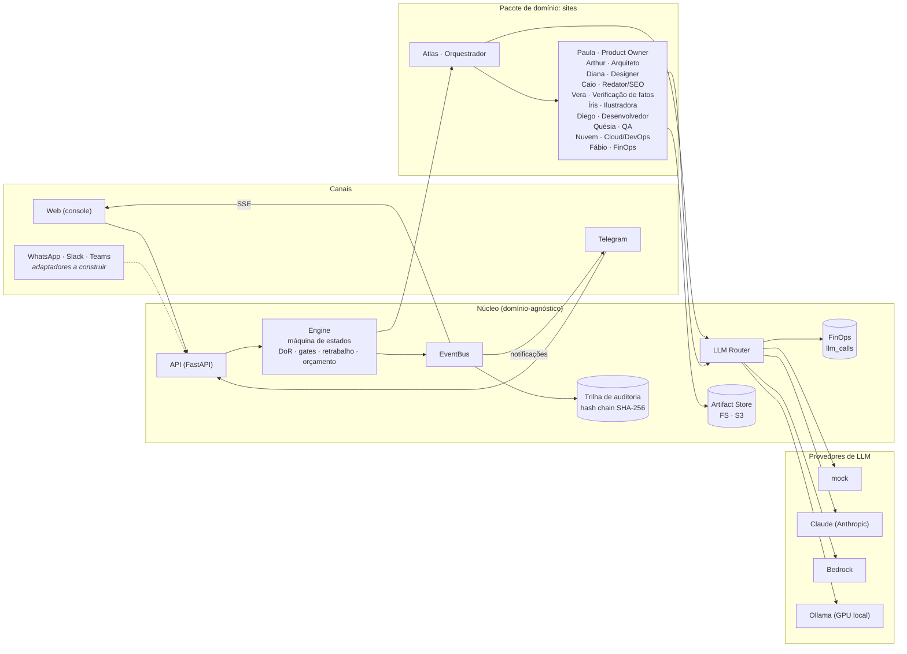
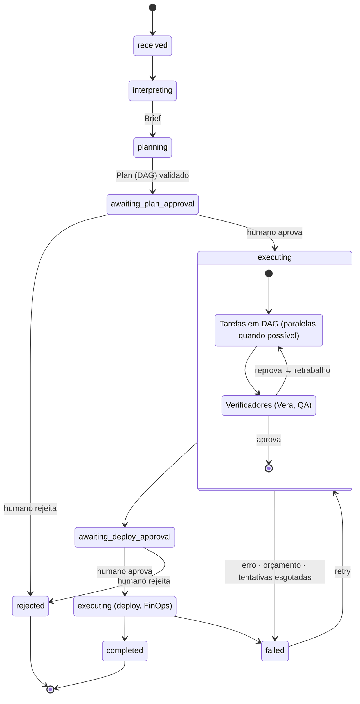

# Arquitetura

## Visão geral

## Ciclo de vida de uma missão

- **Interpretação**: o orquestrador gera um `Brief` estruturado e registra as premissas que assumiu.
- **Planejamento**: o orquestrador gera um `Plan` (DAG). Antes da execução, a plataforma valida:
  - se os papéis existem;
  - se as dependências existem;
  - se há ciclos;
  - o **DoR**, ou seja, se todo `inputs_required` tem produtor upstream.

  Se o plano do LLM violar alguma regra, entra o plano de referência, e a substituição fica registrada (`plan.corrected`).
- **Delegação**: cada tarefa recebe uma história (`user_story`, critérios de aceite, insumos e entregas). Antes de despachar, o motor confere de novo se os insumos existem (`task.dor_failed` em caso de falha).
- **Verificação e retrabalho**: um agente verificador (QA) que reprova devolve as dependências com os apontamentos, até `HIVE_MAX_REWORK_ATTEMPTS`.
- **Portões humanos**: há dois, aprovação do plano e da implantação. O registro inclui quem aprovou, quando e o comentário.

## Rastreabilidade e auditoria

- **Eventos** (`events`): append-only, encadeados por SHA-256. `hash = sha256(prev_hash | evento)`. `GET /api/missions/{id}/audit` recalcula a cadeia, e qualquer edição ou remoção aponta o evento onde ela quebra (há teste automatizado para isso).
- **Ator** em todo evento: papel do agente, `user:<id>` ou `system`.
- **Artefatos** versionados (v1, v2…) com SHA-256 e autor. O deploy confere se o que foi publicado é byte a byte o que o QA aprovou.
- **Chamadas de LLM** (`llm_calls`): provedor, modelo, tokens, custo e latência, por agente, tarefa e missão.

## Do local para a AWS

| Responsabilidade | Local (hoje) | AWS (alvo) |
|---|---|---|
| API + SSE | uvicorn | ECS Fargate atrás de ALB |
| Execução das tarefas | `asyncio` no processo | SQS + workers Fargate, ou Step Functions (mesma máquina de estados) |
| Banco | SQLite | RDS PostgreSQL / Aurora Serverless v2 (`HIVE_DATABASE_URL=postgresql+asyncpg://…`) |
| Eventos (pub/sub) | memória | EventBridge ou SNS + SSE no ALB |
| Artefatos | sistema de arquivos | S3 (implementar `ArtifactStore`), com Object Lock para auditoria |
| Sites publicados | `/sites/{id}` | S3 + CloudFront (Terraform gerado pelo agente Cloud) |
| LLM | mock / Anthropic / Ollama | Bedrock (`HIVE_LLM_PROVIDER=bedrock`, IAM, sem chave) |
| Segredos | `.env` | Secrets Manager |
| Telegram | long polling | webhook (API Gateway + Lambda) |
| Observabilidade | logs | CloudWatch + X-Ray / OpenTelemetry |

**Por que funciona:** o motor é uma máquina de estados **retomável**. Cada passo lê o estado do banco e avança, e o `recover()` retoma o trabalho depois de um reinício. Trocar o `asyncio` por fila ou Step Functions não muda o domínio.

## Decisões (ADRs resumidas)

1. **Orquestração supervisor → workers, determinística no fluxo e com LLM no conteúdo.** O LLM decide o *quê* (briefing, plano, conteúdo); o código garante o *como* (DAG, DoR, gates, orçamento). Isso evita loops autônomos caros e imprevisíveis.
2. **Saída estruturada por schema (Pydantic) em toda chamada.** Contratos fortes entre agentes; validação na fronteira.
3. **QA determinístico.** Verificações objetivas não precisam de LLM: custo zero e resultado reprodutível.
4. **Mock como provedor de primeira classe.** Demo, testes e CI sem custo, com custo-sombra para estimar o gasto real.
5. **Pacotes de domínio.** O núcleo não conhece "site". Novos nichos (apps, licitações, FinOps de contas AWS) entram como novos agentes + plano de referência.

## Verificação de fatos e retrabalho em cascata

- A verificadora (Vera) roda logo depois do conteúdo. Anos citados sem fonte no pedido são reprovados de forma
  determinística; o LLM extrai as demais afirmações factuais (origem, pessoas, números, prêmios, preços) e marca as que o
  pedido e o briefing não sustentam. O que for reprovado volta ao redator.
- Na última tentativa a missão não trava: as pendências seguem para o portão de go-live, onde a pessoa decide.
- Quando um verificador devolve trabalho, tudo o que já tinha sido feito em cima dele é reaberto (ex.: conteúdo
  refeito reabre a verificação de fatos e as ilustrações), para nenhuma etapa ficar validada sobre uma versão antiga.

## Imagens

A ilustradora (Íris) pede ao LLM ilustrações em SVG. A plataforma higieniza cada uma (XML válido, sem scripts, sem eventos `on*`, sem referências externas, tamanho máximo). Uma ilustração inválida é trocada por arte procedural na paleta do design system, e a troca fica registrada como evidência reprovada. Com Claude ou com um modelo de imagem, o mesmo contrato (`images.json`) aceita PNG/WebP gerados.

## Próximos passos sugeridos

- `S3ArtifactStore`, `SqsDispatcher` e IaC da própria plataforma (Terraform/CDK).
- Adaptadores WhatsApp (Meta Cloud API), Slack (Bolt) e Teams (Bot Framework), herdando de `channels/base.py`.
- Autenticação no console (Cognito) e multi-tenant (`tenant_id` em todas as tabelas).
- Prompt caching nos prompts de sistema; evals por agente para comparar provedores (Claude × local).
- Alembic para migrações.
- AWS Pricing MCP (awslabs) consultado pela plataforma e entregue aos agentes FinOps e Cloud, no lugar da tabela fixa de preços.
- Hive como servidor MCP: submeter missões, aprovar e consultar auditoria/FinOps a partir do Claude Code ou de uma IDE.
